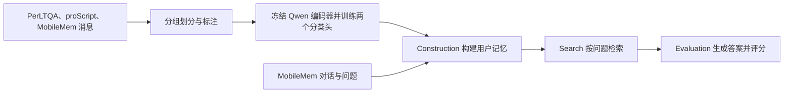

# HGP3-2200 数据构建与改进

HGP3-2200 用于 iPhone 本地自动分类和 MobileMem 对比实验。2200 指训练消息数，另有 343 条验证消息和 334 条测试消息。

[相对原版 HGP 的实现](#相对原版-hgp-的实现) · [数据构建](#1-构建分类数据) · [历史评测](#历史端到端结果) · [下载实验产物](#下载实验产物) · [Windows 复跑](#6-复跑命令与产物) · [macOS 复跑](hgp3-2200-macos.md)

## 相对原版 HGP 的实现

原版 HGP 的 `Memory.add` 调用原有分类流程，按返回的标签集合写入记忆。MobileMem 实验保留原版的四类存储，使用 `OriginalHGPLayer` 接入 MemBase，并调整了消息路由、写入追踪和 Working 检索。[原版 HGP](../HGP-/memory/__init__.py) · [MemBase 桥接](../scripts/hgp_original_layer.py)

- **逐条消息路由。** 冻结 Qwen 编码器，通过两个分类头分别选择主记忆和判断 Working State。实验开启 DeepSeek 低置信度复判，可按用户用复判后确认的样本更新分类头。[路由代码](../scripts/hgp3_router.py) · [分类器训练](#2-训练-hgp3-2200-分类器)
- **按来源记录写入。** 事件和 Working 状态使用消息原始时间，桥接层按消息 ID 保存路由和各类写入状态，重跑时跳过已完成的写入。[构建记忆](#3-construction-构建记忆)
- **检索 Working 历史。** 按问题在状态轨迹中用 BM25 检索，分数相同时优先返回较新的状态。语义、事件和流程记忆沿用原版 HGP 的检索入口。[按问题检索](#4-search-按问题检索)

## 1. 构建分类数据

| 来源 | Train | Val | Test | 样本和标签 |
| --- | ---: | ---: | ---: | --- |
| 中文 PerLTQA | 1,000 | 97 | 84 | 人物描述和关系映射为 `semantic`，事件映射为 `episodic` |
| proScript 中文改写 | 400 | 54 | 58 | 将英文流程改写成中文方法回答，映射为 `procedural` |
| MobileMem | 800 | 192 | 192 | 逐条会话消息，由 DeepSeek 标注主类别和 working |
| **合计** | **2,200** | **343** | **334** | 总计 2,877 条 |

### 下载源数据

将 `PocketMemory-data.zip` 解压到项目根目录，保留下面的相对路径。 [下载 PocketMemory 数据 ZIP](https://drive.google.com/file/d/1rpNIjcEW3qmnFAbtix0H-LizOpjnDrVS/view?usp=sharing)

- `data/external/PerLTQA/Dataset/zh/perltmem.json`，中文 PerLTQA。
- `data/text/mobilemem_data.json`，MobileMem 会话和评测题，可用于复跑实验。
- `outputs/proscript-dialogue-600/proscript-zh.json`，proScript 中文改写和 `review_required` 标记。

从 `outputs` ZIP 恢复 `outputs/hgp3-train-2200/annotations-unified/dataset.json` 后，可以直接训练，也可以把它传给准备脚本的 `--annotations`，用数据 ZIP 中的 PerLTQA 和 MobileMem 重建历史划分。缺少 `synthetic.jsonl` 时，脚本从历史标注复用 512 条已选中的 proScript 样本，保留场景分组和原划分。 [重建分类数据和权重](#重建分类数据和权重) · [下载实验产物](#下载实验产物)

### 样本来源与划分

- **中文 PerLTQA。** 从 `data/external/PerLTQA/Dataset/zh/perltmem.json` 提取人物描述和社会关系，直接映射为 `semantic`，把事件正文映射为 `episodic`。以人物分组，三组分别取 500、50、50 条 `semantic`，其余是 `episodic`。
- **proScript 中文改写。** 先用 DeepSeek 把存档候选中的英文流程改写成中文方法回答，再单独调用模型检查步骤、顺序和事实是否保留。使用 `synthetic.jsonl` 选样时，准备脚本保留自动检查通过、无需人工复核且未标记源流程问题的记录，标为 `procedural`，并沿用上游按场景分组的划分。[proScript 改写脚本](../scripts/synthesize_proscript.py)
- **MobileMem。** 从 `data/text/mobilemem_data.json` 提取非空会话消息，保留消息和会话 ID、角色及可用的时间戳。每位用户预留约五分之一的 session，把完整的预留 session 分给验证集和测试集，各 192 条消息。其余 session 用来构建候选池，最后保留 800 条训练消息。同一用户可以出现在多个划分，单个 session 只出现在一个划分。

准备脚本使用种子 42 和基于 ID 的确定性哈希排序。准备和训练均检查重复 ID、跨划分分组和规范化正文重叠。准备阶段输出 `candidates.jsonl`、`val.jsonl`、`test.jsonl` 和记录划分的清单。[数据准备脚本](../scripts/prepare_hgp3_2200.py)

### 标签与人工复核

- 主类别四选一，`semantic` 对应稳定事实、属性或关系，`episodic` 对应具体事件和经历，`procedural` 对应可复用方法或规则，`null` 表示没有合适的主记忆。
- `working_state` 独立判断当前任务、进展、阻碍或待跟进事项，可与任一主类别同时成立。PerLTQA 和 proScript 的 `working_state=null` 表示缺少监督。Working 头的 800 条训练监督全部来自 MobileMem。
- MobileMem 标注使用 `deepseek-flash`、关闭 thinking、温度为 0。每项请求包括匿名编号、角色和目标消息正文，返回主类别、有明确证据的所有类别、working、是否不确定和理由。默认每批 8 条、12 个 worker，批次可从 `.checkpoint.json` 继续。训练时主分类头读取主类别。[标注脚本](../scripts/label_hgp3_2200.py) · [标注提示词](../scripts/hgp-message-label-prompt.txt)
- `uncertain=true` 的记录进入人工复核。训练读取 `human_review.reviewed=true` 的标签覆盖原标注，遇到未解决的不确定记录或待标注的 MobileMem 记录会停止。历史记录中 train、val、test 分别有 8、1、1 条人工复核。[训练加载器](../scripts/train_hgp3_2200.py) · [历史标签统计](classifier-training-and-weights.md)

标注脚本把三种来源合并为 `annotations-unified/dataset.json`，文件按 `train`、`val`、`test` 保存。复用历史 `dataset.json` 可保留当时的样本和标签。重新调用模型可能改变样本、标签和数据哈希。[下载实验产物](#下载实验产物) · [重建分类数据和权重](#重建分类数据和权重)

| 生效标签 | Train | Val | Test |
| --- | ---: | ---: | ---: |
| Semantic | 577 | 64 | 65 |
| Episodic | 705 | 82 | 72 |
| Procedural | 755 | 145 | 151 |
| Null | 163 | 52 | 46 |
| Working 为 true | 358 | 105 | 83 |
| Working 为 false | 442 | 87 | 109 |

## HGP3-2200 工作流

MobileMem 实验用 2200 路由器逐条处理对话，写入 HGP 的四类记忆，再按问题检索、生成答案并评分。



## 2. 训练 HGP3-2200 分类器

输入为 `annotations-unified/dataset.json`，顶层包含 `train`、`val`、`test`。在 CPU 上冻结 Qwen3-Embedding-0.6B，将每条正文编码为 L2 归一化的 1,024 维向量。训练只拟合两个 sklearn `LogisticRegression` 头，共 5,125 个权重与偏置参数。

| 分类头 | 训练输入 | 推理输出 | 存档超参数 |
| --- | --- | --- | --- |
| 主类别 | 全部 2,200 条训练消息 | 4 个 logits 经温度缩放和 softmax，取概率最大的类别 | `C=10`，`class_weight=balanced` |
| Working | 800 条有布尔监督的训练消息 | 1 个 logit 经 sigmoid，概率达到 0.26 时输出 true | `C=100`，`class_weight=balanced` |

每个头比较 `C ∈ {0.1, 1, 10, 100}` 与 `class_weight ∈ {None, balanced}` 的 8 种组合，按 MobileMem 验证集的 macro-F1 选模型。主类别在同一验证集上按 log-loss 选择温度，在至少接受 20 条且接受部分标签一致率达到 90% 的条件下最大化覆盖率。存档配置的温度为 **1.214195**，离线回退阈值为 **0.824191**。Working 阈值独立按验证集 macro-F1 选出。测试集用于最终评分。训练目录里已有 `metrics.json` 时，可运行 `--evaluate-only` 刷新其中的评估指标。 [训练脚本](../scripts/train_hgp3_2200.py)

训练输出 `head.pt`、`config.json`、`metrics.json` 和 `embeddings.npz`。向量缓存按数据 SHA-256 和本地模型文件信息校验。原项目保存了上述训练产物和最终标注。历史 `dataset.json` 已核对与存档 checkpoint 的 `data_sha256` 一致，SHA-256 为 `563fc61028ddfae33f5467084fc94d3bc62bf71bde5bd9b4b99ff41edaebc522`。

### 存档的分类器结果

| 评测集合 | 消息数 | 主类标签一致率 | 主类 Macro-F1 | 本地接受数 | 接受部分一致率 | Working Macro-F1 |
| --- | ---: | ---: | ---: | ---: | ---: | ---: |
| 全部 Test | 334 | 82.93% | 0.7987 | 191 | 93.72% | — |
| MobileMem Val | 192 | 72.40% | 0.6456 | 64 | 90.63% | 0.8135 |
| MobileMem Test | 192 | 70.31% | 0.6514 | 61 | 80.33% | 0.8436 |

上表使用离线固定阈值，分数衡量与数据标签的一致程度。MobileMem 测试集只有 1 条有人工复核标记。验证集的接受部分一致率达到约 90%，测试集为 80.33%。端到端问答使用第 5 节的评分指标。

## 3. Construction 构建记忆

入口为 `run-mobilemem-comparison.ps1 -Method hgp -Stage construction`。启动器向 MemBase 注册 `OriginalHGPLayer`。默认输入为完整的 `data/text/mobilemem_data.json`，样本数取文件中的轨迹数，种子为 42。每条轨迹有自己的用户目录和图命名空间，标准化后的轨迹及问答写到 `MobileMem_stage_1.json`。[HGP 启动器](../scripts/run_hgp_membase.py) · [MemBase construction 入口](https://github.com/zjunlp/MemBase/blob/a9ba9495d48541d3e68588ff097294cc7a1201bc/memory_construction.py)

每条非空消息由 Qwen 分类器输出主类别及 working 状态。主类别置信度低于本轮阈值时，由 DeepSeek 复核两个输出。`null + false` 没有写入目标，`null + true` 单独写入 working，有主类别且 working 为 true 时可以同时写入两类记忆。Qwen 的 1,024 维向量用于消息路由，原版 HGP 存储和向量检索使用独立的本地 512 维 `distiluse-base-multilingual-cased-v2`。

| 类型 | 写入内容 | 存储位置 |
| --- | --- | --- |
| Semantic | 从消息提取属性、关系等事实三元组，关联来源消息 ID | Neo4j `semantic` 库 |
| Episodic | 带时间戳、参与者和来源 ID 的事件及其关联图 | Neo4j `episodic` 库及用户目录 `episodes.jsonl` |
| Procedural | 规则标题、适用条件和执行步骤 | 用户目录 `procedural_rules.jsonl` |
| Working | 按消息时间记录工作状态及转移轨迹 | 用户目录 `working/state_trajectory.json` |

`ingestion.sqlite3` 记录路由及每类写入。重跑时按消息 ID 复用已记录的路由，跳过已经完成的写入。构建完成后记录 `ready`，供 Search 确认可加载。回退结果中的 `uncertain` 会阻止该样本进入增量缓冲，桥接层仍按回退给出的类别和 working 状态写入。模板默认关闭 LLM 回退及抽取，完整实验入口启用两者。Semantic 和 Procedural 写入需要启用抽取。[HGP 原版存储桥接](../scripts/hgp_original_layer.py) · [实验配置模板](../config/templates/hgp_neo4j.json)

### 构建过程中的增量学习

模板开启 `adaptive_updates`。接受阈值从 0.9 起步，按成功更新次数 `k` 计算 `max(0.5, 0.9 × exp(-0.05 × k))`。增量样本来自低置信度消息经 DeepSeek 复核后的确定标签。代码排除 MobileMem 分类验证和测试消息的 ID、原始数据或增量缓冲中已有的规范化正文，以及与基础训练或累计样本最大余弦相似度达到 0.90 的正文。

积累 100 条合格样本后，在原始 2,200 条训练消息和该用户所有累计合格样本上重新拟合两个头。Working 仍只使用有相应标签的样本。更新沿用离线确定的 `C`、类别权重、温度和 working 阈值。权重、轮次和缓冲写入用户目录 `adaptive-router.pt`，基础 checkpoint 供所有用户初始化。关闭 `adaptive_updates` 时，实验采用固定的 `tau0`。[路由与更新代码](../scripts/hgp3_router.py)

## 4. Search 按问题检索

`-Stage search` 读取 `MobileMem_stage_1.json`，遍历 `[0, 轨迹数)`。MemBase 按用户加载已有记忆，把每题的 `question` 文本和 `TopK` 交给 HGP。参考答案随题目写入结果，供下一阶段评分。批量实验通过 `OriginalHGPLayer` 的普通构造入口加载该运行的配置。[MemBase search runner](https://github.com/zjunlp/MemBase/blob/a9ba9495d48541d3e68588ff097294cc7a1201bc/membase/runners/search.py)

| 记忆 | 检索方式 |
| --- | --- |
| Semantic | 从该用户的语义图取候选三元组，按问题的向量相似度筛选 |
| Episodic | 使用原版 HGP 混合检索，结合问题结构解析、事件图、向量相似度和 BM25 重排 |
| Procedural | 按规则 embedding 的余弦相似度检索 |
| Working | 对状态文本和时间戳建 BM25 索引，中文采用相邻字对，同分时较新的状态优先 |

HGP 将同一个 `k` 传给各路，各取至多 `k` 条，再按类别拼接。比如 `TopK=5` 时，一题可以返回多于 5 条。每题结果包含 `user_id`、`qa_pair` 和 `retrieved_memories`，写入 `<TopK>_0_<轨迹数>.json`。记忆元数据可包含类型、来源 ID、分数、事件时间等。[HGP 检索适配](../scripts/hgp_original_layer.py) · [原版 HGP 检索](../HGP-/memory/__init__.py)

**时间协议**采用先构建整段会话历史、再逐题检索的方式。MobileMem 将 `effective_timestamp` 保存在题目元数据中，当前批量检索只传入问题正文和 `k`，没有按该时间戳裁剪每题可见记忆。分类数据的 session 留出与下游的完整轨迹建库分别用于各自的评测。[MobileMem 数据适配](https://github.com/zjunlp/MemBase/blob/a9ba9495d48541d3e68588ff097294cc7a1201bc/membase/datasets/mobilemem.py) · [MemBase search runner](https://github.com/zjunlp/MemBase/blob/a9ba9495d48541d3e68588ff097294cc7a1201bc/membase/runners/search.py)

## 5. Evaluation 生成答案并评分

1. `-Stage evaluation` 读取与 Search 相同 `TopK`、相同轨迹范围的检索 JSON。`build_hgp_qa_context` 将结果按语义关系、带时间的事件、条件和步骤规则、working 历史组装成 QA 上下文。
2. MemBase 用默认问答提示词，把问题和检索上下文交给 `deepseek-flash` 生成回答。评分阶段对照 `golden_answers` 计算 F1、BLEU 和 LLM Judge。Judge 模型也使用 `deepseek-flash`。
3. 逐题预测、指标、检索内容和用户 ID 写入 `<TopK>_0_<轨迹数>_evaluation.json`，终端输出整体及按题型的平均指标。[HGP 上下文组装](../scripts/hgp_original_layer.py) · [MemBase evaluation runner](https://github.com/zjunlp/MemBase/blob/a9ba9495d48541d3e68588ff097294cc7a1201bc/membase/runners/evaluation.py) · [指标入口](https://github.com/zjunlp/MemBase/blob/a9ba9495d48541d3e68588ff097294cc7a1201bc/membase/datasets/base.py)

### 历史端到端结果

存档的 `hgp-history-time-qa` 覆盖两名用户的 1,319 道题，F1 为 **0.0941**，BLEU 为 **0.1078**。历史评测先生成回答并计算逐题 F1 和 BLEU，再由 `deepseek-flash` 按 `default-exact-match` 规则独立评分，判定正确 878 题，正确率 **66.57%**。

这次运行按来源消息的时间校正了事件和 working 状态轨迹。分享的归档在 `outputs/mobilemem-qwen/hgp-history-time-qa/` 下提供 Top-5 检索、QA 输出和 Judge 报告。

## 下载实验产物

从 Google Drive 下载并解压，将 `outputs/` 放到项目根目录，与 `scripts/` 同级。若本地已有 `outputs/`，按下表复制所需文件，保留已有运行。 [下载 outputs ZIP](https://drive.google.com/file/d/1J7TxH57XUXF4oxxzkcYbJW08zs7PL3jp/view?usp=sharing)

| 用途 | 项目根目录下的路径 |
| --- | --- |
| iPhone 本地自动分类 | `outputs/hgp3-train-2200/classifier/head.pt` 和同目录的 `config.json` |
| MobileMem 增量路由 | 上述分类头和配置，以及同目录的 `embeddings.npz` 和 `outputs/hgp3-train-2200/annotations-unified/dataset.json` |
| 查看历史评测 | `outputs/mobilemem-qwen/hgp-history-time-qa/` 下的检索结果、问答评测、Judge 报告和两个用户的增量路由权重 |

管理员实时实验搜索需要原运行的用户记忆文件和对应的 Neo4j 数据库。缺少 `live-config.json` 时，Companion 可以根据同一次实验的归档和 Neo4j 图生成。 [下载源数据](#下载源数据) · [Companion Quick Start](../README.md#quick-start)

## 使用现成分类器

在 iPhone 收件箱启用本地自动分类时，按上表放置配套的 `head.pt`、`config.json`，并安装本地 Qwen 模型。iPhone 入口关闭增量更新。MobileMem 实验模板开启增量更新，需要同时恢复与权重匹配的 `dataset.json` 和 `embeddings.npz`。 [模型安装](../iphone-companion/README.md#安装分类模型) · [分类器设计与历史权重](classifier-training-and-weights.md)

## 6. 复跑命令与产物

以下命令在 `PocketMemory-v1` 根目录的 PowerShell 中执行。示例使用安装教程创建的 `.venv`，依赖参照实验环境快照。端到端运行前还需准备 Qwen 和 512 维存储模型、固定版本的 MemBase 三个实验入口和原始 `data/text/mobilemem_data.json`，启动支持两个独立数据库的 Neo4j 实例，并在 `config/local.env` 填写 `NEO4J_USERNAME`、`NEO4J_PASSWORD` 和 `DEEPSEEK_API_KEY`。Neo4j 地址和数据库名取自实验配置。 [安装教程](../README.md#quick-start) · [依赖快照](../requirements-experiment.txt) · [MemBase 版本](../patches/membase/base-commit.txt)

```powershell
$py = (Resolve-Path ./.venv/Scripts/python.exe).Path
```

### 恢复 proScript 中文改写

要从完整的 proScript 候选池重新选样，从训练备份恢复 `outputs/proscript-dialogue-600/synthetic.jsonl`。如果只有存档的 `candidates.jsonl`，用 `--data` 显式传入该文件。改写脚本读取其中的 proScript 行，沿用各行的 ID 和划分，并用 DeepSeek 分别改写和复核。重新调用模型可能改变结果、通过复核的数量以及最终数据的哈希。旧候选池的生成方法可用 `git show be961e6:docs/hgp3-training.md` 查看。

```powershell
& $py scripts/synthesize_proscript.py --data '<存档 candidates.jsonl 的路径>'
```

### 重建分类数据和权重

先从数据 ZIP 恢复 PerLTQA 和 MobileMem。已有历史 `dataset.json` 时，可以用下面的命令重建历史划分。脚本检查各划分内 MobileMem 的 ID、正文、会话和角色后沿用原标注，直接生成 `outputs/hgp3-train-2200-rebuilt/annotations-unified/dataset.json`。

```powershell
$archived = 'outputs/hgp3-train-2200/annotations-unified/dataset.json'
& $py scripts/prepare_hgp3_2200.py --annotations $archived
```

要从完整候选池重新选样并标注 MobileMem，先恢复 `synthetic.jsonl`，再执行下面的命令。示例把重建结果写到独立目录，`$qwen` 指向本地模型目录。

```powershell
$rebuilt = Join-Path $PWD 'outputs/hgp3-train-2200-rebuilt'
$annotations = Join-Path $rebuilt 'annotations-unified'
$trainData = Join-Path $annotations 'dataset.json'
$classifierDir = Join-Path $rebuilt 'classifier'
$qwen = (Resolve-Path ./models/qwen3-embedding-0.6b).Path

& $py scripts/prepare_hgp3_2200.py --out $rebuilt
& $py scripts/label_hgp3_2200.py --data $rebuilt --out $annotations
# 复核 dataset.json 中标为 uncertain 的条目，再运行训练。
& $py scripts/train_hgp3_2200.py --data $trainData --model $qwen --out $classifierDir
```

重建的权重和数据应成对使用。运行原 `head.pt` 且开启增量学习时，需要恢复与 `config.json` 中 `data_sha256` 匹配的 `dataset.json` 和对应的 `embeddings.npz`。基础权重配置保存了训练机上的 Qwen 绝对路径。迁移历史产物时，在运行副本的 `classifier/config.json` 中将 `encoder` 指到本机的模型目录。

### 构建、检索和评测

从归档恢复 `outputs/` 后，先按上节说明更新分类器配置里的 `encoder`，再用下面的命令复跑。若分类器在独立目录，将 `$classifierDir` 和 `$trainData` 改为该次训练的绝对路径。每次独立实验使用自己的输出目录和图命名空间。

```powershell
$classifierDir = Join-Path $PWD 'outputs/hgp3-train-2200/classifier'
$trainData = Join-Path $PWD 'outputs/hgp3-train-2200/annotations-unified/dataset.json'
$runName = 'hgp3-2200-' + (Get-Date -Format 'yyyyMMdd-HHmmss')
$runDir = Join-Path $PWD "outputs/mobilemem-qwen/$runName"
New-Item -ItemType Directory -Path $runDir | Out-Null
$cfgPath = Join-Path $runDir 'live-config.json'
$cfg = Get-Content -Raw -Encoding UTF8 ./config/templates/hgp_neo4j.json | ConvertFrom-Json
$cfg.save_dir = $runDir
$cfg.graph_namespace = $runName
$cfg.allow_llm_fallback = $true
$cfg.allow_llm_extraction = $true
$cfg | Add-Member -NotePropertyName classifier_dir -NotePropertyValue $classifierDir
$cfg | Add-Member -NotePropertyName training_data -NotePropertyValue $trainData
[IO.File]::WriteAllText($cfgPath, ($cfg | ConvertTo-Json -Depth 8))

& $py scripts/run_hgp_membase.py init-graph --config-path $cfgPath
if ($LASTEXITCODE -ne 0) { throw 'Neo4j initialization failed.' }
$run = @{
    Method = 'hgp'
    Python = $py
    ConfigPath = $cfgPath
    TopK = 5
    Workers = 2
    QaBatchSize = 8
    UsageLogPath = (Join-Path $runDir 'deepseek-qa-usage.jsonl')
}
& ./scripts/run-mobilemem-comparison.ps1 @run -Stage check
& ./scripts/run-mobilemem-comparison.ps1 @run -Stage construction
& ./scripts/run-mobilemem-comparison.ps1 @run -Stage search
& ./scripts/run-mobilemem-comparison.ps1 @run -Stage evaluation
```

通用入口的 `check` 是静态检查，固定检查 `outputs/hgp3-train-2200/classifier/head.pt` 是否存在。Construction 和 Search 通过配置里的 `classifier_dir` 与 `training_data` 加载本次分类器。Search 和 Evaluation 使用同一个 `TopK`。

| 产物 | 后续用途 | 获取方式 |
| --- | --- | --- |
| `annotations-unified/dataset.json` | 训练及增量学习回放 | 从归档恢复或重建 |
| `classifier/head.pt`、`config.json` | 基础权重和配置 | 从归档恢复或重新训练 |
| `classifier/metrics.json` | 离线分类指标 | 从训练备份恢复或重新训练 |
| `classifier/embeddings.npz` | 向量缓存及增量学习初始化 | 从归档恢复或用匹配输入重建 |
| `MobileMem_stage_1.json`、用户记忆目录及 Neo4j 图 | Search 的标准化数据与记忆 | 由 Construction 生成 |
| `<TopK>_0_<轨迹数>.json` | Evaluation 的逐题检索输入 | 由 Search 生成 |
| `<TopK>_0_<轨迹数>_evaluation.json` | 逐题答案和问答指标 | 由 Evaluation 生成 |
